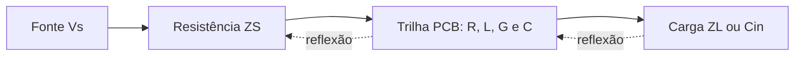

# Guia simples do SI-Wave Laplace

Este documento explica o que o programa faz, como usar a interface e como os principais resultados são calculados. Ele foi escrito para que qualquer integrante do grupo consiga entender o experimento e apresentá-lo, mesmo sem conhecer todos os detalhes matemáticos.

**Aplicação:** <https://mesql1.github.io/thermosignal/>

---

## 1. O programa em uma frase

O **SI-Wave Laplace** simula como um sinal elétrico percorre uma trilha de placa de circuito impresso, perde energia, demora para chegar ao destino e pode refletir quando encontra uma carga diferente da impedância da trilha.

## 2. Qual problema ele ajuda a entender?

Em sinais lentos, uma trilha curta pode ser tratada quase como um fio ideal. Em sinais rápidos, isso deixa de funcionar. O sinal não aparece instantaneamente em toda a trilha: ele se propaga como uma onda.

Ao chegar à carga, três situações podem acontecer:

- A carga absorve a onda quase completamente.
- Parte da onda é absorvida e parte retorna.
- Quase toda a onda retorna para a fonte.

Essas reflexões podem causar picos, oscilações e dificuldade para distinguir os bits 0 e 1. O simulador permite observar esses efeitos no tempo, na frequência, no diagrama do olho e em uma representação 3D.



## 3. O caminho seguido pelo programa

O cálculo é feito nesta ordem:

1. O usuário define a geometria e o material da trilha.
2. O programa calcula a impedância nominal e a velocidade de propagação.
3. A geometria é convertida nos parâmetros elétricos R, L, G e C.
4. O canal é representado no domínio de Laplace.
5. São calculadas as reflexões na fonte e na carga.
6. A função de transferência informa quanto do sinal chega à carga.
7. A inversão numérica de Laplace gera a tensão ao longo do tempo.
8. A mesma resposta é usada para formar o diagrama do olho.
9. Os resultados alimentam os gráficos e a cena 3D.

## 4. Como usar a aplicação

### 4.1 Sequência recomendada

1. Escolha um experimento na lista **Experimento**.
2. Clique em **Aplicar preset**.
3. Observe os quatro valores principais: impedância, atraso, Nyquist e transferência.
4. Veja a propagação na representação 3D.
5. Abra a aba **Sinal** para observar a tensão no tempo.
6. Abra **Reflexões** para entender a origem dos picos.
7. Abra **Olho** para verificar o efeito sobre uma sequência de bits.
8. Use **Frequência** para observar perdas e ressonâncias.
9. Consulte **Laplace** para relacionar os gráficos com as equações.

A cena 3D pode ser recolhida para liberar espaço. Ela acompanha a rolagem normal da página e não precisa permanecer aberta durante a análise dos gráficos.

### 4.2 Controles principais

| Controle | Significado | Efeito esperado |
|---|---|---|
| Comprimento ℓ | Tamanho da trilha | Aumenta o atraso e as perdas |
| Data Rate | Quantidade de bits por segundo | Reduz o tempo disponível para cada bit quando aumenta |
| Tempo de subida `tr` | Rapidez da transição elétrica | Tempos menores excitam frequências mais altas |
| `w` | Largura da trilha | Altera impedância, resistência e capacitância |
| `h` | Distância ao plano de referência | Altera o campo elétrico e a impedância |
| `t` | Espessura do cobre | Altera principalmente a resistência |
| `εr` | Permissividade do dielétrico | Altera velocidade, atraso e impedância |
| `tanδ` | Perda dielétrica de referência | Aumenta a atenuação |
| `ZS` | Resistência da fonte | Controla o lançamento e a reflexão na fonte |
| `ZL` | Resistência da carga | Controla a reflexão na carga |
| `Cin` | Capacitância de entrada | Suaviza e deforma transições rápidas |
| Posição `x` | Ponto observado na trilha | Mostra a tensão antes de chegar à carga |
| Termos de Talbot | Precisão da inversão numérica | Mais termos podem ajudar, mas valores excessivos também aumentam erro numérico |

## 5. O que significa cada área da tela

### Resumo superior

- **Impedância nominal:** oposição característica da trilha à propagação da onda.
- **Atraso da trilha:** tempo aproximado que a primeira onda leva da fonte até a carga.
- **Nyquist:** metade da taxa de dados. É uma frequência importante para avaliar um sinal digital.
- **Transferência em Nyquist:** relação entre a tensão recebida e a tensão da fonte nessa frequência.

### Representação 3D

A cena mostra substrato, cobre, planos de referência, fonte, carga e posição `x`.

- Verde: onda incidente.
- Amarelo: reflexão com polaridade dominante positiva.
- Vermelho: reflexão com polaridade dominante negativa.
- Branco: posição de medição.

A velocidade foi reduzida para a animação ficar visível. O atraso verdadeiro aparece numericamente. A cena é uma explicação visual da propagação, não uma simulação tridimensional completa do campo eletromagnético.

### Aba Sinal

Mostra tensão em função do tempo:

- **Fonte ideal `vS(t)`:** sinal antes da resistência da fonte.
- **Carga `vL(t)`:** sinal recebido no final da trilha.
- **Posição `x`:** sinal em um ponto escolhido pelo usuário.

As linhas de 30% e 70% ajudam a observar níveis e tempo de subida. O programa também informa pico, overshoot, undershoot e subida de 10% a 90%.

### Aba Olho

Sobrepõe muitos intervalos de bits. Um olho aberto indica maior separação entre 0 e 1. Um olho fechado indica que reflexões e memória do canal estão misturando bits vizinhos.

As métricas são estimativas educacionais:

- **Altura:** separação vertical robusta entre níveis altos e baixos.
- **Largura:** estimativa do intervalo horizontal disponível.
- **Jitter pico a pico:** variação observada no instante das transições.
- **DCD:** diferença entre o comportamento das bordas de subida e descida.

### Aba Reflexões

Mostra o caminho das ondas entre fonte e carga. Cada linha representa uma viagem. Ao atingir uma extremidade, a onda pode retornar com amplitude e polaridade diferentes.

Este gráfico usa um modelo ideal sem perdas para deixar o conceito mais claro. Por isso, ele não reproduz exatamente todos os detalhes do gráfico temporal.

### Aba Frequência

Mostra como o canal responde a senoides de várias frequências:

- `|H(jω)|`: ganho ou perda de tensão.
- `α`: atenuação por metro.
- `β`: variação de fase por metro.

Picos no gráfico podem aparecer por interferência entre ondas incidentes e refletidas. O valor mostrado é uma razão de tensões, não uma medição certificada de S-parameters.

### Aba Laplace

Reúne as equações que geram os resultados. Ela serve para mostrar que os gráficos derivam do mesmo modelo matemático e não de curvas desenhadas manualmente.

## 6. Cálculos explicados em etapas

### 6.1 Conversão de unidades

Os controles são fáceis de ler, mas o motor trabalha no Sistema Internacional:

- milímetros são convertidos para metros;
- micrômetros são convertidos para metros;
- picofarad são convertidos para farad;
- picosegundos são convertidos para segundos;
- gigahertz são convertidos para hertz.

Essa conversão é importante porque misturar unidades produziria resultados incorretos.

### 6.2 Geometria e impedância nominal

O programa oferece duas geometrias:

- **Microstrip:** trilha na superfície e um plano de referência abaixo.
- **Stripline:** trilha entre dois planos de referência.

Para microstrip, é usada a aproximação de Hammerstad–Jensen com correção da espessura do cobre. Para stripline, é usada uma aproximação de espessura finita baseada em Wadell/IPC.

Essas fórmulas usam principalmente `w`, `h`, `t` e `εr` para calcular:

- impedância nominal `Z0`;
- permissividade efetiva `εeff`.

Não é necessário decorar as fórmulas geométricas completas para a apresentação. A ideia principal é:

> Alterar a geometria muda a distribuição do campo elétrico; isso muda a impedância e a velocidade da onda.

### 6.3 Velocidade e atraso

A velocidade aproximada da onda é:

```text
v = c / √εeff
```

onde `c` é a velocidade da luz no vácuo.

O atraso da trilha é:

```text
atraso = comprimento / velocidade
```

Exemplo da configuração inicial:

```text
comprimento = 100 mm
velocidade ≈ 163,8 milhões de m/s
atraso ≈ 611 ps
```

Portanto, a primeira alteração na carga só pode aparecer depois de aproximadamente 611 ps.

### 6.4 Parâmetros R, L, G e C

A trilha é dividida conceitualmente em pequenos trechos. Cada trecho possui:

| Parâmetro | Nome | O que representa |
|---|---|---|
| R | Resistência série | Perda no cobre |
| L | Indutância série | Campo magnético |
| G | Condutância paralela | Perda no dielétrico |
| C | Capacitância paralela | Campo elétrico entre trilha e plano |

Depois de encontrar `Z0` e `v`, o programa calcula:

```text
C = 1 / (v · Z0)
L = Z0² · C
```

Essas expressões mantêm as relações de uma linha de transmissão:

```text
Z0 ≈ √(L/C)
v ≈ 1/√(LC)
```

### 6.5 Resistência do cobre

A resistência contínua por metro é:

```text
Rdc = 1 / (σ · w · t)
```

onde `σ` é a condutividade do cobre.

Em frequências altas, a corrente se concentra perto da superfície do condutor. Esse fenômeno é chamado **efeito pelicular**. No modelo, a parcela de resistência causada por ele cresce aproximadamente com `√f`:

```text
R(f) = Rdc + Rskin · √f
```

Consequência prática: componentes de frequência mais alta perdem mais amplitude.

### 6.6 Perda no dielétrico

O controle `tanδ` representa a perda dielétrica de referência. Para manter o modelo causal no domínio de Laplace, o programa usa uma aproximação de Debye calibrada em 1 GHz:

```text
Y(s) = s · [C∞ + ΔC/(1 + sτ)]
```

Ela produz a condutância `G` e a capacitância dependentes da frequência. O `tanδ` informado coincide com o valor configurado em 1 GHz; fora dessa frequência ele varia.

Para uma apresentação simples, basta dizer:

> O dielétrico real não é perfeito. Parte da energia vira calor, principalmente quando a frequência aumenta.

### 6.7 Equações dos telegrafistas

R, L, G e C são reunidos nas equações da linha:

```text
∂V/∂x = −(R + sL)I
∂I/∂x = −(G + sC)V
```

O símbolo `s` pertence à Transformada de Laplace. Ele permite tratar variações no tempo, perdas e transitórios dentro do mesmo modelo.

Das equações são obtidos dois resultados centrais:

```text
γ(s)  = √[(R + sL)(G + sC)]
Z0(s) = √[(R + sL)/(G + sC)]
```

`γ` é a constante de propagação:

```text
γ = α + jβ
```

- `α` informa quanto a onda perde amplitude.
- `β` informa quanto a fase muda durante o percurso.

### 6.8 Reflexões

A reflexão na carga é calculada por:

```text
ΓL = (ZL − Z0) / (ZL + Z0)
```

A reflexão na fonte é:

```text
ΓS = (ZS − Z0) / (ZS + Z0)
```

Interpretação:

| Valor de Γ | Resultado |
|---|---|
| 0 | Não há reflexão |
| Próximo de +1 | Reflexão forte com mesma polaridade |
| Próximo de −1 | Reflexão forte com polaridade invertida |

Casos importantes:

- Carga casada: `ΓL ≈ 0`.
- Carga aberta: `ΓL = +1`.
- Curto-circuito: `ΓL = −1`.

### 6.9 Exemplo da configuração inicial

Na configuração inicial:

```text
Z0 ≈ 47,9 Ω
ZS = 25 Ω
carga aberta → ΓL = +1
```

A fração inicialmente lançada na trilha é:

```text
Vincidente/Vs = Z0/(ZS + Z0)
              ≈ 47,9/(25 + 47,9)
              ≈ 0,657
```

Ao chegar a uma carga aberta, a onda soma sua reflexão positiva:

```text
Vcarga inicial ≈ 0,657 · (1 + 1)
               ≈ 1,314 V para uma fonte de 1 V
```

Por isso o gráfico mostra um pico próximo de 1,31 V. Depois, novas viagens entre carga e fonte alteram a tensão até ela se aproximar do valor final. As perdas fazem o valor simulado diferir ligeiramente do cálculo ideal.

### 6.10 Função de transferência

A função de transferência relaciona a tensão na carga com a tensão da fonte:

```text
H(s) = VL(s) / VS(s)
```

O programa inclui lançamento, propagação, reflexão na carga e múltiplas viagens:

```text
H(s) = [Z0/(ZS+Z0)] · [(1+ΓL)e^(−γℓ)]
       / [1−ΓSΓL e^(−2γℓ)]
```

O denominador representa as reflexões que continuam viajando entre as duas extremidades.

### 6.11 Sinal de entrada e Transformada de Laplace

Uma transição instantânea teria frequência infinita e provocaria artefatos numéricos. Por isso a entrada padrão é uma rampa com tempo de subida finito:

```text
VS(s) = [1 − e^(−s·tr)] / (s²·tr)
```

O sinal de saída no domínio de Laplace é:

```text
VL(s) = H(s) · VS(s)
```

Para voltar ao tempo:

```text
vL(t) = L⁻¹{VL(s)}
```

### 6.12 Inversão numérica de Talbot

Nem sempre existe uma fórmula simples para a transformada inversa. O programa usa o método de **Talbot fixo**, que avalia a função em vários pontos complexos e combina os resultados para estimar `v(t)`.

O usuário pode selecionar de 8 a 32 termos. O padrão é 20. Os atrasos puros são separados antes da inversão para melhorar a estabilidade numérica.

O motor calcula 1.025 amostras. Cada novo ajuste cancela o cálculo anterior, espera 30 ms para evitar trabalho desnecessário e executa a simulação em um Web Worker para não travar a interface.

## 7. Como o diagrama do olho é construído

1. O motor calcula uma única resposta de referência.
2. A diferença entre duas respostas separadas por 1 UI gera o pulso de um bit.
3. É criada uma sequência de 1.152 bits.
4. Cada bit 1 adiciona uma cópia deslocada do pulso.
5. Os 128 bits iniciais são descartados para evitar o início artificial da simulação.
6. Mais de 500 janelas de 2 UI são sobrepostas.
7. Regiões com mais passagens ficam visualmente mais claras.

Uma UI é o tempo de um bit:

```text
UI = 1 / Data Rate
```

Para 5 Gbps:

```text
UI = 1/(5 × 10⁹) = 200 ps
```

O atraso inicial de 611 ps corresponde a aproximadamente 3,05 UI.

## 8. Como as métricas são calculadas

### Overshoot

```text
overshoot = maior tensão − tensão final
```

### Undershoot

É a parte do sinal que fica abaixo de zero.

### Tempo de subida

É a diferença entre a primeira passagem por 10% e a primeira passagem por 90% da tensão final.

### Altura do olho

O programa mede os níveis no centro dos bits. Para evitar que um único ponto anormal domine o resultado, usa percentis:

```text
altura = percentil 1% dos níveis altos
       − percentil 99% dos níveis baixos
```

### Jitter determinístico

O limiar é o ponto médio entre nível alto e baixo. O programa interpola o instante de cada cruzamento e calcula:

```text
jitter pico a pico = cruzamento mais tardio − cruzamento mais cedo
```

### Largura estimada

```text
largura estimada = UI − jitter pico a pico
```

Essa largura é apenas uma estimativa didática. Ela não substitui uma máscara de conformidade nem uma medição de BER.

### DCD

```text
DCD = |média das subidas − média das descidas|
```

## 9. Frequência de Nyquist

Para sinais digitais, o programa destaca:

```text
fNyquist = Data Rate / 2
```

Para 5 Gbps:

```text
fNyquist = 2,5 GHz
```

Isso não significa que o sinal só possui frequências até Nyquist. Bordas rápidas contêm harmônicas acima desse valor. Nyquist é usado aqui como um ponto de referência consistente para comparar configurações.

## 10. Presets disponíveis

| Preset | O que demonstra |
|---|---|
| Configuração inicial | Reflexões fortes e overshoot |
| Casado | Redução da reflexão na carga |
| Aberto | Reflexão positiva máxima no modelo ideal |
| Capacitivo | Transição mais lenta e dependente da frequência |
| Trilha longa com perdas | Atenuação, atraso e memória maiores |
| PCIe Gen4 | Exemplo educacional de bordas rápidas |
| DDR5 | Exemplo educacional com carga R em paralelo com C |

Os presets PCIe e DDR5 não são modelos certificados desses padrões.

## 11. Quatro experimentos para apresentar

### Experimento 1 — Casado contra aberto

1. Aplique **Casado**.
2. Observe `ΓL`, overshoot e gráfico temporal.
3. Aplique **Aberto**.
4. Compare o aumento da reflexão e do pico.

**Conclusão esperada:** aproximar a carga da impedância da trilha reduz reflexões.

### Experimento 2 — Carga capacitiva

1. Aplique **Capacitivo**.
2. Aumente `Cin`.
3. Observe o tempo de subida e o olho.

**Conclusão esperada:** uma capacitância maior dificulta transições rápidas e aumenta a memória do canal.

### Experimento 3 — Comprimento e Data Rate

1. Aplique **Trilha longa com perdas**.
2. Aumente o comprimento.
3. Aumente a Data Rate.
4. Compare atraso em UI e abertura do olho.

**Conclusão esperada:** quanto maior a trilha e menor o tempo disponível por bit, maior a interferência entre bits.

### Experimento 4 — Perda dielétrica

1. Mantenha geometria e terminações.
2. Aumente `tanδ`.
3. Observe `α`, `|H|` e o olho.

**Conclusão esperada:** aumentar a perda dielétrica reduz componentes de alta frequência e deforma as bordas.

## 12. Validação do motor

O botão **Validar motor** cria um caso separado e simples:

- linha sem perdas;
- `ZS = 25 Ω`;
- `ZL = 100 Ω`;
- subida de 100 ps;
- 80 amostras.

O resultado de Talbot é comparado com uma solução analítica por reflexões sucessivas. A validação passa quando o erro máximo fica abaixo de `10⁻⁵ V`.

Os testes automáticos também verificam:

- números complexos;
- períodos das sequências PRBS;
- conversão de geometria;
- terminações;
- causalidade;
- consistência entre respostas no tempo e na frequência;
- ausência de métricas estatísticas enganosas para um bit isolado.

## 13. Limitações importantes

O simulador é educacional. Ele não substitui um solucionador eletromagnético ou uma medição de laboratório.

Não são modelados:

- vias e conectores;
- rugosidade detalhada do cobre;
- acoplamento entre trilhas e crosstalk;
- pares diferenciais;
- radiação;
- modelos IBIS de transmissores e receptores;
- equalização;
- recuperação de clock;
- ruído e jitter aleatórios;
- máscaras oficiais de conformidade.

As fórmulas geométricas são aproximações quase-TEM. Geometrias extremas podem produzir maior erro. O modelo de Debye é calibrado em 1 GHz e não mantém `tanδ` constante em toda a faixa.

## 14. Roteiro curto para apresentação

### Apresentação de 3 minutos

1. **Problema:** “Em sinais rápidos, a trilha deixa de se comportar como um fio ideal.”
2. **Modelo:** “Representamos a trilha por R, L, G e C distribuídos.”
3. **Propagação:** “A geometria determina impedância, velocidade e atraso.”
4. **Reflexão:** “Diferenças entre Z0, ZS e ZL fazem parte da onda retornar.”
5. **Laplace:** “Calculamos o canal no domínio de Laplace e usamos Talbot para voltar ao tempo.”
6. **Resultado:** “Os mesmos cálculos alimentam o sinal, o olho, as reflexões, a frequência e o 3D.”
7. **Demonstração:** compare os presets Casado e Aberto.

### Frase de encerramento

> O objetivo do simulador é tornar visível a relação entre a construção física da trilha e a qualidade do sinal digital recebido.

## 15. Perguntas comuns

### Por que a carga pode receber mais de 1 V se a fonte é de 1 V?

Porque a tensão incidente pode se somar a uma reflexão positiva. Isso não significa criação de energia; corrente, impedância e energia também precisam ser consideradas.

### Por que a tensão demora para aparecer?

Porque a onda se propaga com velocidade finita no dielétrico. O atraso é comprimento dividido pela velocidade.

### Por que uma trilha de aproximadamente 50 Ω não mede 50 Ω com um multímetro?

Os 50 Ω são a impedância característica para ondas em propagação. Não são simplesmente a resistência contínua do cobre.

### Por que aumentar a Data Rate fecha o olho?

Cada bit passa a ter menos tempo. Reflexões e caudas de bits anteriores ocupam uma parcela maior da UI e interferem no bit atual.

### O 3D mostra o campo eletromagnético real?

Não. Ele mostra a geometria e uma representação didática da propagação e das reflexões. O cálculo usado nos gráficos é o modelo de linha de transmissão RLGC.

### O programa simula exatamente PCIe ou DDR5?

Não. Esses presets são exemplos educacionais. Uma análise de conformidade precisaria de modelos, canais, máscaras e condições específicas do padrão.

## 16. Glossário

| Símbolo | Significado |
|---|---|
| `w` | Largura da trilha |
| `h` | Distância ao plano de referência |
| `t` | Espessura do cobre |
| `ℓ` | Comprimento da trilha |
| `εr` | Permissividade relativa do dielétrico |
| `σ` | Condutividade do cobre |
| `R`, `L`, `G`, `C` | Parâmetros elétricos por metro |
| `Z0` | Impedância característica |
| `ZS` | Resistência da fonte |
| `ZL` | Impedância da carga |
| `Cin` | Capacitância de entrada |
| `ΓS`, `ΓL` | Coeficientes de reflexão |
| `γ` | Constante de propagação |
| `α` | Atenuação |
| `β` | Constante de fase |
| `H(s)` | Função de transferência |
| `UI` | Tempo de um bit |
| PRBS | Sequência pseudoaleatória de bits |
| ISI | Interferência entre símbolos |
| DCD | Distorção do ciclo de trabalho |
| Talbot | Método numérico de inversão de Laplace |

## 17. Onde cada cálculo está no código

Para quem precisar relacionar a apresentação com a implementação:

| Parte | Arquivo |
|---|---|
| Números complexos, PRBS e Talbot | `web/src/si/numerics.mjs` |
| Geometria, RLGC e canal | `web/src/si/channel.mjs` |
| Resposta temporal e olho | `web/src/si/channel.mjs` |
| Interface, gráficos e 3D | `web/src/si/page.html` |
| Montagem do HTML único | `web/src/si/assemble.mjs` |
| Testes numéricos | `web/src/si/*.test.mjs` |

---

## Resumo final

O simulador começa com a geometria física, calcula a impedância e os parâmetros R, L, G e C, monta o canal no domínio de Laplace e recupera a resposta temporal por inversão numérica. Reflexões aparecem quando fonte, trilha e carga não possuem impedâncias compatíveis. Os mesmos resultados são apresentados em diferentes formas para facilitar a compreensão: cena 3D, tensão no tempo, diagrama de reflexões, diagrama do olho e resposta em frequência.
